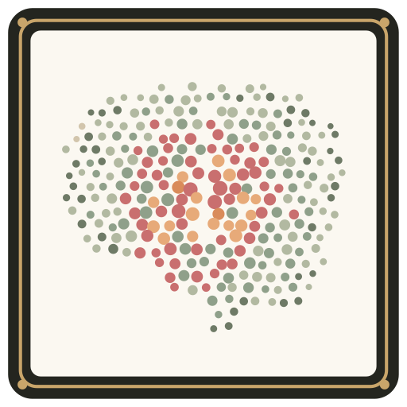

<p align="center"></p>
<h1 align="center">Visual Brain</h1>
<p align="center"><strong>No-fuss Pinterest, on your own computer.</strong><br>Save any image from the web with one click. Arrange it on infinite boards. Find it later. Nothing leaves your machine.</p>

<p align="center"><a href="https://visual-brain-production-9eb4.up.railway.app/brand/demo.mp4">▶ 35-second silent demo</a> · <a href="https://visual-brain-production-9eb4.up.railway.app">Live playground</a> · <a href="https://github.com/rishvaiyer/visual-brain-app/releases/latest">Download</a></p>

**Live demo:** https://visual-brain-production-9eb4.up.railway.app (shared public playground, wiped every few hours)

## Run it in two commands

```sh
python3 -m pip install -r requirements.txt
python3 server.py
```

Open http://127.0.0.1:8777. On a Mac you can double-click `Open Visual Brain.command` instead; it starts the server and opens the browser for you.

Needs Python 3.10 or newer. No database server, no accounts, no cloud.

## What you get

- **Boards and folders.** An infinite canvas per board. Text, frames, shapes, and freehand drawing alongside your images. Pan, zoom, drag, resize, rotate, crop.
- **Library.** Every image is stored once and can sit on many boards. Titles, tags, collections, favorites, and Trash with restore.
- **Search.** Type to search titles, tags, and collections across everything. On a Mac, Apple Vision adds labels and visible text to each image so you can find pictures you never tagged.
- **Browser extension.** Right-click any image in Chrome or Edge, or hover and click the floating button, and it lands on your board at the best resolution the page offers.
- **Fonts.** Add your own TTF, OTF, WOFF, or WOFF2 fonts and type with them on the board. Five open fonts are bundled in `fonts/`.
- **Export.** Save a board as a PNG, or everything as a ZIP backup you can restore from.
- **Sample boards.** An empty library offers six ready-made boards to try the app on, and the public playground opens on them. Double-click any picture to see it large. See `demo-seed/NOTICE.md` for where the pictures come from.
- **Image content search (optional, Apple Silicon).** Double-click `Install Local Visual Search.command` once to download a local CLIP model. Then search by what is in the picture, fully offline.

## Browser extension

The `extension` folder is an unpacked Chrome/Edge extension.

1. Open `chrome://extensions` (or `edge://extensions`) and turn on **Developer mode**.
2. Click **Load unpacked** and choose the `extension` folder.
3. In Visual Brain, open **More → Extension setup** and copy the pairing key.
4. Click the extension icon, paste the key, and save.

Now right-click any image for **Save image to Visual Brain**, or hover it and click the floating button. Alt+Shift+S saves the hovered image. The extension only ever talks to `127.0.0.1`.

Details and the request format are in [extension/README.md](extension/README.md).

## Where your data lives

Everything is in `data/` next to `server.py`: a SQLite database, your original image files, and any fonts you added. Back it up by copying that folder or by using **Save all data…** in the sidebar. The folder is ignored by Git.

## Hosting it

Visual Brain is designed to run on your own machine, but it can be hosted. The included `Dockerfile` and `railway.json` work on Railway and anywhere that runs a container.

It refuses to listen on a public address unless you choose one of two modes:

- **Private board:** set `VISUAL_BRAIN_HOST=0.0.0.0`, `VISUAL_BRAIN_PASSPHRASE=<something long>`, and `VISUAL_BRAIN_PUBLIC_ORIGIN=https://your-domain` (Railway sets the origin for you). The landing page is public; the board asks for the passphrase.
- **Public demo:** set `VISUAL_BRAIN_HOST=0.0.0.0` and `VISUAL_BRAIN_DEMO=1`. Anyone can edit, images are capped at 8 MB and 400 total, and all data is wiped every `VISUAL_BRAIN_DEMO_RESET_HOURS` hours (default 6). The browser extension does not pair with hosted instances.

## Development

```sh
python3 tests/test_visual_brain.py          # end-to-end smoke test against a real server
python3 -m unittest tests/test_hosted_security.py
python3 -m unittest tests/test_enrichment.py tests/test_inspo_fonts.py
python3 tests/test_demo_seed.py             # sample boards: seeding, routes, a copy without pictures
node tests/test_extension_menu.js && node tests/test_extension_targets.js && node tests/test_extension_fallback.js
```

Plain Python standard library HTTP server, SQLite, vanilla JavaScript. Two dependencies: `requests` and `Pillow`.

## License

MIT. Bundled fonts keep their own open licenses in `fonts/licenses/`; `vendor/mlx_clip` is MIT from Apple.
